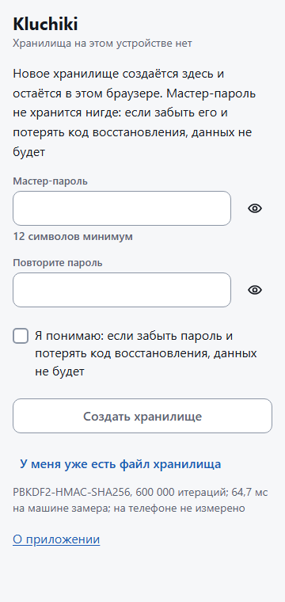
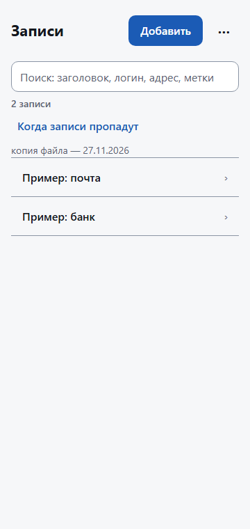
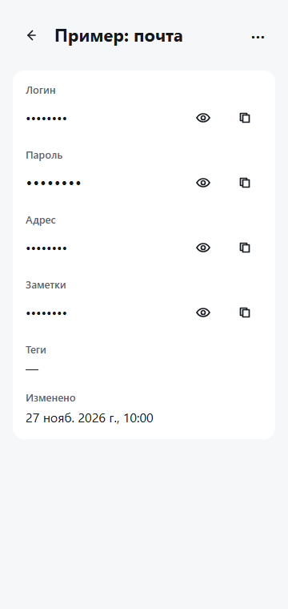

# Kluchiki

Офлайновый менеджер паролей в браузере: ни сервера, ни аккаунта, ни
синхронизации. Живой адрес — https://kluchiki.testersoulja.space/

## Что это

Kluchiki хранит пароли и заметки в одном зашифрованном файле в браузере.
Аккаунта и сервера нет: при первом запуске вы создаёте хранилище с
мастер-паролем, потом открываете его записанным способом. Файл
зашифрован AES-256-GCM, ключ — PBKDF2-HMAC-SHA256 на 600 000 итераций.
Синхронизации нет: перенос только скачанным файлом; забытый пароль без
кода восстановления не вернуть.

«В браузере» значит: шифрует и расшифровывает ваше устройство, внутри
вкладки; сервера, аккаунта и общего хранилища нет. Тело хранилища —
AES-256-GCM с новым IV на каждое сохранение; ключ тела — 32 случайных байта,
в файл он не попадает: там он же, завёрнутый ключом из мастер-пароля. Соль
16 байт новая на каждый слот. Мастер-пароль не хранится нигде; без него от
файла остаются заголовок с параметрами и шифртекст, а подмена байта ломает
расшифровку целиком. Выгрузка: `.vault` зашифрован, CSV — открытым текстом.

**Чего это не даёт** — открытый телефон в чужих руках, кейлоггер, расширение
с доступом к странице, запись экрана, подмена кода на GitHub, офлайн-подбор
слабого мастер-пароля. Подробно —
на [about.html](https://kluchiki.testersoulja.space/about.html).

## Как это выглядит

Первый экран — «Kluchiki» и строка «Хранилища на этом устройстве нет».
На нём поля «Мастер-пароль» и «Повторите пароль» с глазком, чекбокс о
забытом пароле, кнопки «Создать хранилище» и «У меня уже есть файл
хранилища», ссылка «О приложении».

После входа — «Записи»: «Добавить», «Ещё», поиск «Поиск: заголовок,
логин, адрес, метки», счётчик, ссылка «Когда записи пропадут», список
заголовков. «Ещё» ведёт в «Когда записи пропадут», «Способы входа»,
«Экспорт и импорт», «Стереть всё», «Заблокировать».

## Первый запуск — по шагам

1. Откройте https://kluchiki.testersoulja.space/: форма создания,
   хранилища ещё нет.
2. Введите мастер-пароль от 12 символов, повторите его; отметьте
   чекбокс — «Создать хранилище» станет активной.
3. Если есть отпечаток — карточка «Вход по отпечатку?»: «Настроить» или
   «Позже».
4. Откроется «Код восстановления»: 32 символа, восемь групп по четыре.
   Отметьте «Я записал код» → «Продолжить»: код показывается один раз.
5. «Добавить»: заполните «Заголовок» и остальные поля, «Сохранить» —
   откроется карточка записи.
6. Нажмите «Копировать пароль» у строки «Пароль»: тост «Пароль
   скопирован» и строка, что через 30 с приложение попробует очистить
   буфер.
7. «Ещё» → «Заблокировать»: откроется «Хранилище заблокировано».

## Каждый день

На «Хранилище заблокировано» — записанные способы: «Пароль»,
«Файл-ключ», «Код восстановления», «Отпечаток». Раскрывается строка со
статусом «работает». Вход: «Мастер-пароль» → «Разблокировать», «Выбрать
файл-ключ», поле «Код восстановления» или «Отпечаток». Отпечаток требует
поддержки PRF.

Поиск — по заголовку, логину, адресу и меткам; пароль не ищется.
Регистр не важен, ё = е; другая раскладка (ЙЦУКЕН ↔ QWERTY), латиница и
одна опечатка в слове от 4 букв; раскладка и транслит — с двух символов.

На карточке у «Логина», «Пароля», «Адреса» и «Заметок» свой глазок и
кнопка «Копировать» у каждого. Значение скрывается через 60 с, при уходе
и при блокировке.

Через 5 минут без ввода — блокировка; скрытая дольше минуты вкладка
блокируется при возвращении. Перезагрузка не разлогинивает, пока сессия
свежая: ключ в sessionStorage; браузер вправе сохранить его на диск для
восстановления сеанса, срок проверяется.

## Копия и перенос

«Экспорт и импорт» — из «Ещё» или под счётчиком. «Скачать файл»
даёт `kluchiki-ГГГГ-ММ-ДД.vault` — те же байты, что в хранилище. На
списке — «копия файла — 27.11.2026». Импорт заменяет хранилище:
«Выбрать файл», чекбокс «понимаю, что текущее хранилище будет заменено»,
«Импортировать».

CSV: «понимаю, что файл не зашифрован» → «Скачать CSV (открытым
текстом)»; колонки Name, URL, Login name, Password, Notes, Tags. Импорт
файла Kaspersky проверен 27.11.2026, обратная выгрузка не проверялась.
«Импорт CSV» добавляет записи к текущим: «1. Файл», «2. Колонки»,
«3. Предпросмотр».

«Стереть всё»: «СТЕРЕТЬ» (регистр не важен, кириллица) → «Стереть»;
удалятся хранилище, записи, способы и настройки; скачанные файлы и код
на бумаге останутся.

## Где чаще всего теряют записи

Восемь случаев с экрана «Когда записи пропадут»; полный список — на
about.html.

- «Стереть всё» в меню.
- Очистка данных сайта.
- Приватное окно.
- Мало места.
- iPhone и Safari: неделя без визитов.
- Другой браузер или устройство.
- Другой адрес сайта.
- Удаление записи в карточке.

Копия файла спасает от всего списка.

## Чего нет

- Автозаполнения в других приложениях и сайтах.
- Синхронизации файла между устройствами: перенос только файлом.
- Аккаунтов и серверной части.
- Восстановления без кода восстановления.
- Нескольких хранилищ в одном браузере.
- Слота отпечатка там, где его нельзя проверить.

## Как поставить на телефон

- **iPhone:** в Safari нажмите «Поделиться» → «На экран Домой».
- **Android:** в Chrome откройте меню → «Установить приложение».

Установка не создаёт аккаунт. После первой загрузки работает без сети;
первая загрузка требует сети. Проверки шли в Chrome на компьютере; на
настоящем телефоне установка не проверялась.

## Версия

0.6.6, 27.11.2026. Скриншоты, установка и оговорки — на странице
приложения: https://kluchiki.testersoulja.space/about.html
